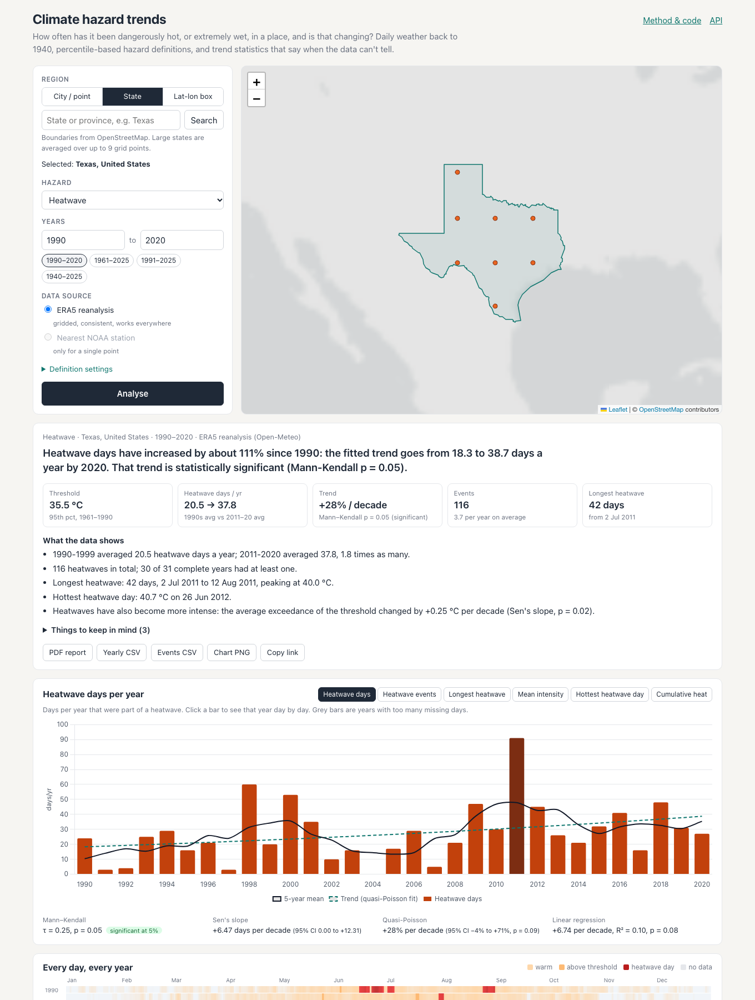

# Climate hazard trends

Pick a city, a state or a lat/lon box and see how often it has had heatwaves
(or heavy-rain days) since 1940, whether that is changing, and how confident
you can be about the answer.

- **App:** https://climate-hazard-trends.ambitiousglacier-2de2de03.eastus2.azurecontainerapps.io/
- **API docs:** https://climate-hazard-trends.ambitiousglacier-2de2de03.eastus2.azurecontainerapps.io/api/docs

It runs on a scale-to-zero free tier, so if nobody has used it for a while the
first load takes ~20 seconds.



The default view is the one the brief asks for: heatwaves, defined as 3+
consecutive days with a daily maximum above the 95th percentile, for a region
and a range of years. On top of that you get a per-year chart with trend lines,
a day-by-year calendar of every hot day, a drill-down for any single year, a
table of events, CSV/PDF/PNG exports, and a plain-English summary that only
says "increased" when the statistics back it up.

## Running it

With Docker (API, frontend and MongoDB):

```bash
docker compose up --build
# open http://localhost:8000
```

Without Docker you need Python 3.12+, Node 20+ and a MongoDB somewhere:

```bash
cd backend
python -m venv .venv && . .venv/bin/activate
pip install -r requirements-dev.txt
cp .env.example .env            # points at mongodb://localhost:27017
uvicorn app.main:app --reload   # :8000
python -m pytest                # 52 tests, no network needed

cd ../frontend
npm install
npm run dev                     # :5173, proxies /api to :8000
```

`STORAGE=memory` runs the API without Mongo if you just want to poke at it.

### Deployment

The live instance is a single container on **Azure Container Apps** (it
serves both the API and the built frontend, so there's no CORS in play).
The database is **Azure Cosmos DB for MongoDB** on its free tier, and the image
sits in a Basic container registry. `deploy/azure.sh` has the exact commands.
The app scales to zero when idle, so the first request after a quiet spell
takes ~20 s while a replica starts.

Two Cosmos quirks the code handles. Its Mongo API historically only allowed
TTL indexes on its own `_ts` field, so the store falls back to that and
checks expiry on read anyway. It also has no retryable writes, which the
connection string turns off.

`render.yaml` deploys the same image to Render with MongoDB Atlas instead, if
you'd rather not use Azure. `scripts/warm_cache.py` pre-computes a few
popular regions from your own machine, so the demo doesn't spend the shared
server's Open-Meteo quota.

## How it fits together

```
 browser (React + Leaflet + Chart.js)
     |  POST /api/v1/analyses {region, hazard, years, baseline, ...}
     v
 FastAPI ── rate limits, validation, security headers
     |
     |  id = sha256(normalised request + algorithm version)
     |  analyses[id] in Mongo? ──yes──> return it (that's most requests)
     |  no
     v
 resolve region ──> sample points on the ERA5 0.25° grid
     |                (Nominatim polygon for states)
     v
 series cache in Mongo ──missing years only──> Open-Meteo / NOAA
     |
     v
 QC + area mean ──> thresholds ──> events ──> yearly indicators
     ──> trend tests ──> summary text ──> stored in analyses[id]
```

Three Mongo collections:

| collection | holds | notes |
|---|---|---|
| `series` | daily values per (source, variable, grid cell or station) | zlib-compressed int16 in tenths of a unit; 65 years of Tmax is ~25 KB instead of ~400 KB as a BSON array, which matters on a 512 MB free cluster |
| `analyses` | finished analyses (events, yearly indicators, trends, text, QC) | `_id` is the request hash, so repeats and shared links are one lookup; 60-day TTL since they can be rebuilt from `series` |
| `lookups` | place searches, state polygons, station lists | TTL index |

Code layout, roughly in the order data flows through it:

```
backend/app/
  sources/       openmeteo.py, ghcn.py, nominatim.py, http.py (retries, size caps)
  regions.py     points / boxes / polygons -> weighted grid points
  series.py      read-through cache, fetches only missing spans
  cleaning.py    units, calendar alignment, QC, gap filling
  hazards.py     thresholds, event detection, yearly indicators
  trends.py      Mann-Kendall, Sen, quasi-Poisson, OLS
  insights.py    the summary sentences and caveats
  analysis.py    orchestration, single-flight, persistence
  api.py, main.py, ratelimit.py, store.py, exports.py
frontend/src/    App.tsx and components/
```

## Data sources

**ERA5 reanalysis via the Open-Meteo archive API** (default). Global, daily,
from 1940, no gaps. I pin `models=era5`: Open-Meteo's default `best_match`
switches to the 9 km IFS model from 2017 onwards, which would put a change of
model in the middle of most trend windows. Their own docs recommend pinning
ERA5 or ERA5-Land for multi-decade work.

The free tier is 10,000 calls a day, but a "call" is weighted:
`max(1, nvars/10 × days/14)` per location (I read this out of their server
code). So 65 years of one variable at one grid cell costs ~170 calls, and a
9-point state costs ~1,500. That number shaped a lot of the design:

- only the variable the hazard needs is fetched (Tmax for heatwaves);
- sample points are snapped to the ERA5 grid, so nearby cities and
  overlapping regions share cached cells;
- only missing years are fetched (widening 1990–2020 to 1990–2023 costs
  three years, not sixty);
- all points of a region go in one multi-location request;
- a client-side budget mirrors Open-Meteo's minute/hour/day windows, waits
  for the next minute if that's short, and otherwise fails early with a
  `Retry-After` instead of collecting 429s. The UI retries automatically.

**NOAA GHCN-Daily stations** (optional, single locations only). This is the
messy real-world source: missing days, station moves, and values NOAA's own
QC has flagged. I use the NCEI search service to find stations within 75 km
whose record covers at least 75% of the needed span, pick the best by
coverage and distance, and download it through the NCEI data service. That
service returns tenths of a unit by default and °F/inches with
`units=standard`. Requesting `units=metric` explicitly avoids a 10× or
Fahrenheit surprise, and the parser still goes through the same unit
normaliser. Any value with a quality flag is dropped and counted.

**OpenStreetMap Nominatim** for state/province boundaries, used within its
policy: at most 1 request a second, an identifying User-Agent, results cached,
and search on submit only (no search-as-you-type). **Open-Meteo geocoding**
for city search.

## Hazard logic

### Heatwave (default)

At least *N* consecutive days (default 3) with Tmax above the *p*-th
percentile (default 95th) of a fixed baseline period (default 1961–1990).

- **Fixed threshold** (default): one number for the whole year. It is what
  the brief describes, and what people mean by a heatwave: the hottest few
  percent of days, which only happen in the warm season.
- **Day-of-year threshold** (option): a separate 95th percentile for each
  calendar day, from a 15-day window across the baseline years, as in the
  ETCCDI indices and Perkins & Alexander (2013). This catches spells that are
  unusually hot *for the time of year*, winter included. Feb 29 shares Feb
  28's threshold.
- **Baseline.** 1961–1990 is the WMO reference period for long-term climate
  change monitoring, so the counts read as "relative to the climate of that
  time". A threshold computed from the analysis window itself would move
  every time you change the years, and two windows couldn't be compared.
  1981–2010 and 1991–2020 are selectable.
- A missing day breaks a run. We can't say a spell lasted three days if we
  didn't see the middle one.
- An event belongs to the year it starts in, all of its days included. A
  spell from 30 Dec to 2 Jan counts towards the December year.

Indicators per year follow Perkins & Alexander (2013): heatwave days (the
headline indicator), number of events, longest event, mean exceedance over
the threshold, hottest heatwave day, and cumulative exceedance (°C·days, a
rough heat-load measure).

### Heavy rainfall

Days above the *p*-th percentile of **wet days** (≥ 1 mm) in the baseline,
like ETCCDI's R95p. Using all days would put the threshold at a light shower
in most dry climates. Indicators: heavy days, events, rain on heavy days
(R95pTOT), wettest day (Rx1day), and the share of the year's rain that fell
on heavy days.

## Trends, and how the summary is worded

Years with more than 15 missing days are left out (the ETCCDI rule). For each
indicator:

- **Mann-Kendall** tests whether there is a monotonic trend at all. It's
  non-parametric, which matters because heatwave counts are skewed and full
  of zeros. When the detrended series is autocorrelated, the variance gets
  the Hamed & Rao (1998) correction. I only let that correction *widen* the
  variance: with 30 points, negative autocorrelation at some lag can make the
  "corrected" test more confident than the plain one, and I'd rather not.
  The implementation is checked against `pymannkendall` in the tests.
- **Sen's slope** (with Gilbert's confidence interval) gives the size of the
  trend for continuous indicators.
- **Quasi-Poisson regression** gives the size of the trend for counts. Sen's
  slope is often exactly zero for counts with many zero years, and OLS can
  predict negative counts. A log-link model gives a rate ratio ("+X% per
  decade"), and the quasi part inflates the standard error for
  overdispersion, which is large here because heatwave days come in clumps.
- **OLS** is shown too, since everyone recognises it, plus a centred 5-year
  rolling mean on the chart.

The headline follows a few rules:

- It only says "increased" or "decreased" when Mann-Kendall p < 0.05.
  Between 0.05 and 0.10 it says the evidence is weak. Above that it says
  there's no clear trend, even if the decade averages differ.
- Percentages come from the fitted trend, not from two noisy end points.
  If the fitted starting level is below one day a year it gives absolute
  numbers instead, because "+400%" from 0.3 days a year means little.
- Caveats are generated for the analysis at hand, not as a generic
  disclaimer. For example: the baseline overlapping the window (Zhang et
  al., 2005), many zero years, a short record, autocorrelation, excluded
  years, area averaging, reanalysis smoothing, unhomogenised station data.

Three real results (1990–2020, 1961–1990 thresholds) show the rules at work:

| region | heatwave days/yr, 1990s → 2011–20 | Mann-Kendall | what the app says |
|---|---|---|---|
| Phoenix | 15.1 → 18.5 | p = 0.42 | no clear trend |
| Paris | 19.6 → 26.4 | p = 0.08 | signs of an increase, weak evidence |
| Karnataka (state) | 18.1 → 27.3 | p = 0.04 | increased by about 119% since 1990 |

A naive "+23% in Phoenix" headline would have been easy to write and wrong
to believe.

## Data handling

In order:

1. **Units.** Everything is converted to °C and mm from the unit the source
   reports. An unknown unit is an error, not a guess.
2. **Calendar alignment.** Values go onto a complete daily calendar. A missing
   date becomes a NaN rather than shifting everything after it, which would
   quietly break "consecutive days". If a date appears twice, the first real
   value wins.
3. **Range checks** with deliberately loose limits (Tmax −90…60 °C, rain
   0…1900 mm). These catch sentinels like −9999 and unit mix-ups, and never
   real extremes, because the extremes are the signal.
4. **Spike check** for temperature. A day is removed only if it jumps more
   than 10 °C away from *both* neighbours in the same direction and is an
   extreme outlier in second differences. A real 4-day hot spell doesn't
   trip it, and there is a test for exactly that.
5. **Area mean.** cos(latitude)-weighted. A day only gets a value if points
   carrying at least half the weight have data.
6. **Gap filling.** Linear interpolation of gaps up to 2 days, temperature
   only. Interpolating rainfall would invent drizzle.
7. **Coverage.** Per-year coverage is shown on the chart (grey bars) and
   counted in the QC panel, along with every value removed at each step.

## Security and performance

- **Caching.** There are three layers: analyses by request hash; daily series
  per grid cell or station, fetched incrementally; and lookups with TTLs.
  Analysis responses are content-addressed, so `GET /analyses/{id}` can be
  cached for a day by browsers and CDNs.
- **Single-flight.** Identical analyses that arrive together share one
  computation. It runs as a task, so it still finishes and gets cached if the
  browser that started it disconnects.
- **Rate limiting.** Per-IP token buckets: general reads, searches, analyses,
  exports, and a separate small budget for analyses that need *new* upstream
  data. Exploring settings on a region that's already cached is cheap;
  asking for fifty new regions isn't. The client IP comes only from headers
  the deployment says to trust (`TRUSTED_PROXY_HOPS` / `CLIENT_IP_HEADER`),
  so a forged `X-Forwarded-For` doesn't buy extra quota. There's a test for
  that.
- **Upstream protection.** Retries only on timeouts and 5xx, with backoff.
  Response bodies are size-capped, every upstream payload is validated
  before use, the Open-Meteo budget is described above, and Nominatim is
  serialised to 1 req/s.
- **Input handling.** Strict pydantic models with `extra="forbid"`, range
  checks on every number, NaN/inf rejected, boxes capped at 20°, years
  limited to finished ERA5 years, and labels stripped of control characters.
  Mongo is only ever queried by `_id` strings the server builds itself, so
  user-supplied operators have nowhere to go. Request bodies over 16 KB are
  refused before they're read.
- **Responses.** CSP, `nosniff`, `X-Frame-Options`, and a CORS allow-list.
  Errors come back as `{error, message}` without stack traces.
- Heavy work (PNG/PDF rendering) runs in a thread pool. JSON responses
  bypass FastAPI's encoder and are gzipped.

## API

| method | path | |
|---|---|---|
| GET | `/api/v1/meta` | years available, hazards, defaults, limits |
| GET | `/api/v1/places?q=` | city search |
| GET | `/api/v1/admin-areas?q=` | state/province search (with polygons) |
| POST | `/api/v1/analyses` | run or fetch an analysis; 201 when computed, 200 from cache (`X-Cache`) |
| GET | `/api/v1/analyses/{id}` | stored analysis |
| GET | `/api/v1/analyses/{id}/annual.csv`, `/events.csv` | exports |
| GET | `/api/v1/analyses/{id}/trend.png?metric=` | trend chart rendered server-side |
| GET | `/api/v1/analyses/{id}/report.pdf` | report with summary, chart, events, caveats |
| GET | `/api/v1/health` | DB status and Open-Meteo quota used |

Interactive docs are at `/api/docs`.

## Assumptions and limitations

- ERA5 is a ~25 km reanalysis. It's consistent over time, which is what
  matters for trends, but it smooths out urban heat islands and coastal
  effects. Percentile thresholds make the counts much less sensitive to its
  absolute biases, though not immune.
- A regional heatwave is one where the *area-averaged* Tmax is above *its
  own* 95th percentile. Local heat in one corner of Texas won't register.
  For large regions that's a real limitation, not just a caveat.
- ERA5 is homogeneous by construction but not perfect. The observing system
  changed (satellites from 1979), and early decades are less constrained.
  Windows starting before ~1960 deserve extra suspicion.
- Station data isn't homogenised, so a station move can look like a trend.
- Only finished years are offered. ERA5's preliminary data for the last ~3
  months can still change, so the latest year becomes available from
  mid-March.
- The rate limiter and the Open-Meteo budget live in process memory. That's
  fine for one instance, but more than one would need them in Redis.
- On the free hosting tier the API sleeps when idle. The first request after
  a quiet spell takes up to a minute, and the UI says so.

## What I'd do with more time

- Heat-stress versions of the heatwave definition (Tmin, or wet-bulb/apparent
  temperature). Hot nights matter more for health than hot afternoons.
- A drought hazard based on SPI-3 or SPEI rather than dry-spell counts.
- The Zhang et al. bootstrap for in-base years, instead of only warning
  about it.
- Per-grid-cell heatwave statistics for regions, so you get "share of the
  state in a heatwave" rather than a heatwave of the average.
- Field significance (or at least a false-discovery-rate control) once more
  than one indicator gets interpreted.
- Batch ingestion straight from the Copernicus CDS for whole regions, which
  avoids the per-point quota problem entirely.
- Move the rate limiter and budget to Redis, and add a job queue so large
  uncached regions don't hold an HTTP request open.
- Frontend tests (Playwright) for the region drawing and the share links.

## Credits

ERA5: Hersbach et al. (2023), Copernicus Climate Change Service / ECMWF,
served by [Open-Meteo](https://open-meteo.com/) (CC BY 4.0). GHCN-Daily:
Menne et al. (2012), NOAA NCEI. Boundaries, geocoding and map tiles ©
OpenStreetMap contributors. Methods: Perkins & Alexander (2013), Zhang et al.
(2005, 2011, ETCCDI), Hamed & Rao (1998), Sen (1968), Gilbert (1987).
